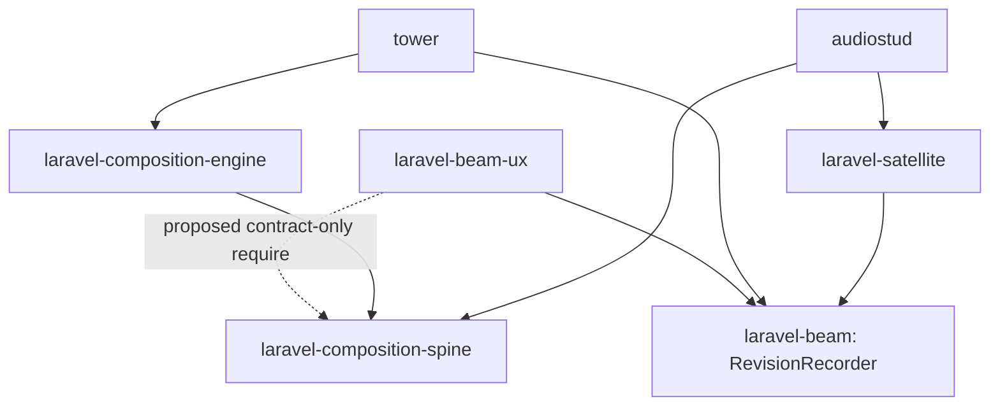

# Node-action contracts live in the composition spine; callers bind the paid gate and recording

Status: Accepted (owner, 2026-11-14)
Date: 2026-11-14

A caller whose persistence is a client session may return the decision shape without a Recorder; kept then means offered, not recorded.

A node action changes an addressed truth payload and its standing; its projection is derived again.
The callers include composition cells, entry bodies and timeline selections, without making an entry
or song a Composition Profile. Propose the shared contract in this existing spine, with inference
and persistence behind consumer-owned bindings. This ADR introduces no runtime code or dependency.
Tickets 03, 04 and 06 must wait for the owner to accept or amend it.

## Proposed ownership and names

All new names below are nominations, not shipped symbols or a frozen field/method schema.

| Piece | Package / proposed name | Boundary |
|---|---|---|
| DTOs | `splicewire/laravel-composition-spine`: `Splicewire\Composition\NodeActions\NodeActionDecisionData` and `NodeActionRevisionData`; request/address and signal Data types under the same module when specified in 03 | Declared data only: outcome, reasons and a reference/projection of the superseded truth and standing. No Eloquent model, closure, provider prompt or storage lookup in a wire shape. |
| Public service port | Same package: `Splicewire\Composition\NodeActions\NodeActionExecutor` | The caller invokes an implementation through the shared contract; no concrete default that invokes a model. |
| Subject / recording ports | Same package: `NodeActionSubject` and `NodeActionRecorder` interfaces | Local adapters supply truth/standing, candidate production, medium signals, projection and revision persistence. Interfaces do not import cell, entry or clip model classes. Local hooks/closures are not serialized into requests. |
| Model-calling gate | `splicewire/tower`, first binding beside `Composition/RefineCell` / `EditorialCritic`; proposed `Composition\NodeActions\CompositionNodeActionGate` | The existing private implementation owns model calls, attribution, grounded prose audit and critic policy. Other media bind their own implementation or an explicit remote adapter. The spine and beam-ux ship no inference implementation. |
| First recorder binding | `splicewire/tower`: proposed `Composition\NodeActions\CellNodeActionRecorder`, delegating to the existing `CellRevisionRecorder` | Preserve the existing log/subject identity and derived output; do not create a new revision table or recorder substrate. |
| Other consumer bindings | `splicewire/laravel-beam-ux` for entry-body adapters; `splicewire/laravel-satellite-timeline` for any later timeline adapter; audiostud's `App` for produced-media selection / remote execution | Each binding uses its own writer, authorization, tenant connection and version boundary. A timeline subtree version and a produced media job are not forced through a cell-attribute restore. These are placement nominations, not extra implementation scope for 02 or 08. |
| Existing generic recorder | `splicewire/laravel-beam`: `Revisions\RevisionRecorder` and `RecordsRevisions` | Stays where it is. The spine does not require beam or Spatie activity-log persistence. Consumers adapt recording; the DTO must not expose a concrete activity model. |

The port is remotely implementable. In particular, beam-ux can consume the contract without requiring
tower or the paid engine. Installing the spine does not promise that refine/regenerate are executable;
the host must bind an actual authorized implementation. A binding keeps each medium's native hard
signal and optional calibrated soft signal, rather than treating prose critic scores as universal.

## Dependency sketch and measurement

Measured from **committed production `composer.json require` edges**, not imports, require-dev, or the
accidental installed vendor closure. The instrument was a `git show <pinned-ref>:composer.json` graph
and breadth-first reachability/cycle check, with declared package-topology rules read alongside it.
The evidence/proof accompanying this ADR includes the script, manifest/ref inventory and graph JSON.
Audiostud's project manifest still says `laravel/react-starter-kit`; the graph explicitly identifies
that one source root as `rushing/audiostud` instead of reporting a false absence for the host.

| Caller at the read ref | Existing route to the contract | Required change after acceptance |
|---|---|---|
| `splicewire/laravel-beam-ux` `ec51057f3047c5e132647e40f836c551e2002937` | **None** to this spine today | Add a direct production require on `splicewire/laravel-composition-spine` when 04 consumes it. This is a new dependency, expressly proposed as a downward contract/SDK edge; it imports neither engine nor satellite/tower behavior. |
| `splicewire/tower` `4294599f4aa1510bf0142eaf385d93702f065493` | tower → laravel-composition-engine → laravel-composition-spine | Declare the spine directly when 03 directly imports its new types; no new reachable implementation tier. |
| `rushing/audiostud` `acaff8628c236bcd0ead5e81c6fc49287f1eac98` | audiostud → laravel-composition-spine directly | No new package edge to read the contract; a remote paid implementation is a runtime transport, not a require on tower. |

Adding the proposed beam-ux edge introduces only two previously unreachable family packages:
laravel-composition-spine and laravel-grounding-spine. The measured graph gains no cycle and no tower,
satellite or composition-engine dependency for beam-ux. The spine's own manifest at
`897b62d93aec9c5c4e35c91d0a20b0e0a9f922e5` requires data-schemas, laravel-data and grounding-spine;
it imports no engine or beam package. Its existing `extra.package-topology` prohibits upward engine
process references. Keep those constraints. Do not solve implementation binding by introducing a
spine → engine/host, beam-ux → tower/satellite/engine, or engine → Eloquent-recorder edge.

This is a proposed layer placement, not a claim that beam-ux already has the dependency. It follows
`splicewire/splicewire-app docs/adr/0168-an-engine-is-persistence-agnostic-substrate-ports-plus-dto-spine-plus-logic-the-host-binds-eloquent.md`:
the remotely implementable spine contains DTOs and interfaces; persistence and inference bindings stay
outside it. The graph checks dependency reachability, not runtime transport availability or licensing.

## What “take” means here

Use **node-action revision** for the contract's superseded truth/standing snapshot or revision
reference. Prefer `NodeActionRevisionData`, not a bare `TakeData`, `Node` or `Take` class. A UI may
label its appropriate revision history “takes”; that does not merge distinct identities.

| Existing sense | Source checked | Relationship to this contract |
|---|---|---|
| Cell rewrite / pre-image | tower `src/Composition/CellRevisionRecorder.php:35–73` | Existing slots/standing revision, with output re-derived after restore. Adapt its identity instead of inventing a second cell-take store. |
| Image choice | tower `src/Composition/Http/Controllers/CompositionCellController.php:369–424` | Chooses a retained candidate token; not a new media generation or, today, a recorded revision. |
| Produced song take | audiostud `app/Models/ProducedTake.php:13–36`, `app/Songs/Iteration/TakeChoices.php:18–43,74–88` | ProviderMediaJob-derived asset/run and product choice, not the revision of a node's truth payload. Keep its existing id/run semantics. |
| “Take file draft” | beam-ux `src/Particle/FileTakeDraftOp.php:19–31` | A reconciliation verb over a release file, not a media take or a generic node revision DTO. |

A ready generated asset may be referenced by a node revision. It does not become that revision.
Research 05's whole-song regeneration and the timeline's existing version APIs remain separate;
this ADR does not promise immediate clip replacement or conflate a queued job with a kept decision.
The new module/name family has no existing declaration under this spine's `src/` at the read ref;
its existing `Io/StructuredNode` remains a different contract.

## Re-taken premises and limits on 03

The 2026-11-12 research was read again against today's train snapshots:

- `tower src/Support/Activity/DataActivityRecorder.php:23–33` **extends beam's RevisionRecorder**;
  `CellRevisionRecorder.php:20,35–73` delegates recording/revert and re-derives the cell output.
  A new generic recorder is unnecessary.
- `laravel-beam src/Revisions/RecordsRevisions.php:26–44` delegates only when explicitly called;
  `Models/BeamParticle.php:62–68` uses the trait. `RevisionRecorder.php:90–105` has the owner/workflow
  snapshot restoration path. Do not bypass it with generic force-fill restoration of an owned body.
- `laravel-beam-ux src/Models/BeamUxEntry.php:471–473` is a **has-a particle**, not its subclass;
  `EntryBodySaveOp.php:110–129` → `Publish/EntryPublication.php:715–745,1020–1027` writes through the
  authoring ParticleWriter boundary. Preserve its validation, connection, draft/publication and version
  rules. A node adapter must not write around that boundary.
- The old editor-parity MAP's blanket claim that editor writes record no activity is stale: current
  `BeamUxEntry.php:389–403` records delete/restore through RevisionRecorder. The entry itself still
  does not use RecordsRevisions; the body particle does. Ordinary body saves use the publication/version
  path; a trait on the particle is not proof that every save calls recordRevision. No new automatic
  recording policy is inferred here.
- Current `tower RefineCell.php:137–181` still saves before audit/critic and reverts on a failed gate;
  `RegenerateCell.php:32–49` drafts before locking, compares standing, then writes/records. This ADR
  chooses neither a new write order nor a new soft-score policy. Research 01's candidate-memory gate
  is a nomination for 03 to prove, not permission to change Studio silently. Approve/unlock/choose
  recording changes likewise require explicit treatment in 03's “unchanged” proof.

## Exposure and convention check

Secret-sauce reasoning: the neutral atom is an addressed truth/standing change and its decision/revision
contract. Existing Studio actions are the shipped capability being abstracted; this new port has no shipped
interpreter until 03 binds it. The ALWAYS-liftable spec/contract override applies to the neutral seam. Recommend **fully-open for the abstract contract**, with named CHANNEL and
CREDIBILITY returns: other editors/remote implementations can implement it without acquiring the
private model-calling gate. Publish the neutral projection, not prompts, grounding strategy, editorial
critic behavior or inference orchestration. The **generation gate stays private-perpetual** (NEVER-lift
engine/generation rule). A paid/hosted implementation or its transport is where charging/ability checks
belong. This proposal changes no license: this spine's current manifest says proprietary, and neither
an open-source release nor re-licensing is authorized by this ticket. No new entity/package is proposed.
A later adapter may qualify for hardening only with a real interpreter and named return; unimplemented
capabilities must not be advertised. Contract exposure follows the charter; dead optional adapters can
be removed rather than claiming a live implementation.

Convention discovery checked the configured scriptorium `conventions/` and the ecosystem's local
convention-marker files. Its library-orientation convention and local prototype/mail/provenance
candidates are **distinct** from this port; no competing port convention was found there. The governing
seam decisions are **compose-on**, not a new convention: ADR-0168's spine/host split, beam-ux's declared
no-satellite/no-tower topology, and beam's particle doctrine for future boundary Data/op declarations.
Repo-local ADR placement composes `splicewire/splicewire-ecosystem docs/conventions/adr-placement.md`;
no fleet/corpus promotion is performed.

## Alternatives and acceptance stop

- **tower**: rejects the page/audio callers' no-upward-dependency condition.
- **beam core**: already reachable by all three and a viable alternative for these callers; it owns the recorder, but puts a remotely implementable
  action SDK beside concrete persistence and invites the paid engine to depend on the host recorder.
  Keep that recorder and adapt it; put the independent contract in the existing persistence-free spine.
- **new package**: cleaner standalone name, but adds a package/lifecycle before the first non-cell binding
  is proven. Revisit only if the contract earns an independent home; do not create it for this proposal.
- **this existing spine**: adds the explicit beam-ux contract dependency above, while preserving the
  engine/host split and avoiding a new package. This is the recommendation for the owner to amend or accept.

Only this PROPOSED ADR is committed in 02. No manifests, contracts, bindings, gates, tables or UI change.
The deciding repo's suite must pass at its commit. Then stop: **03, 04 and 06 remain blocked until the
owner accepts or amends this ADR.** Train publication is not owner acceptance and is not a release.
